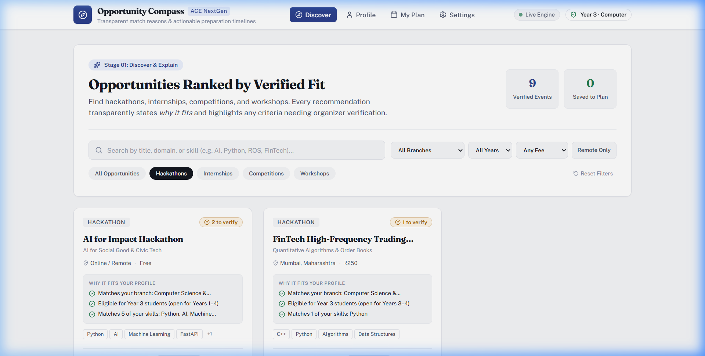
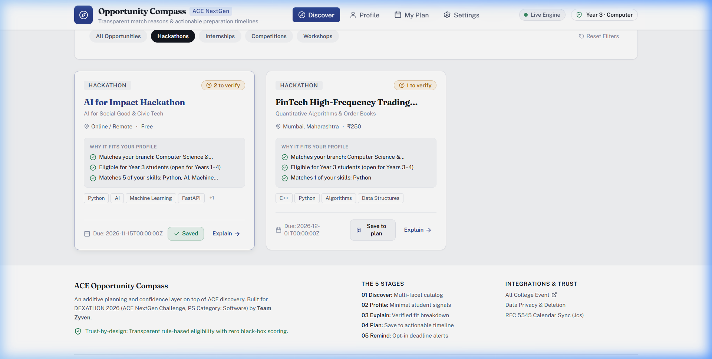
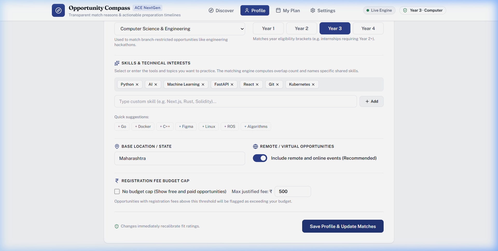
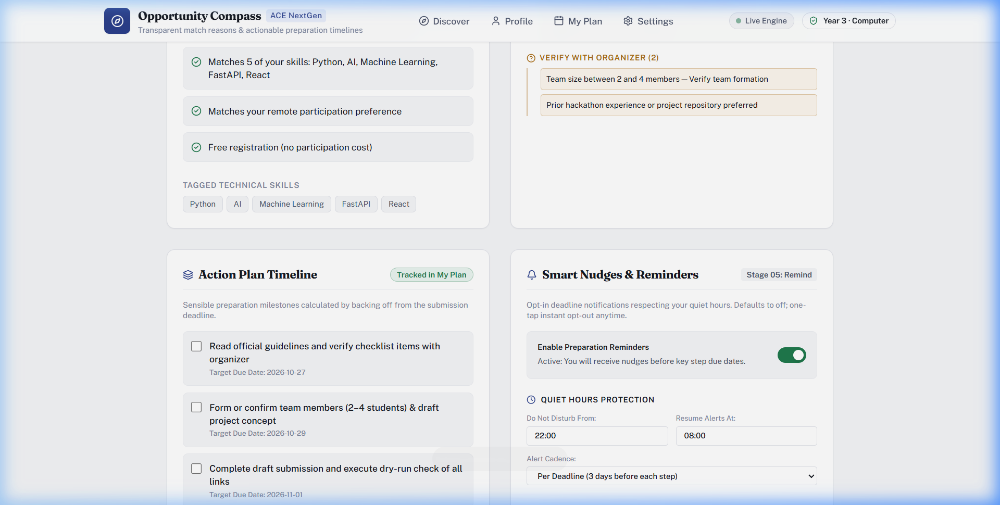
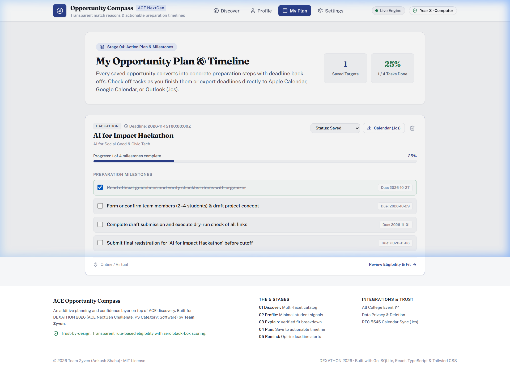
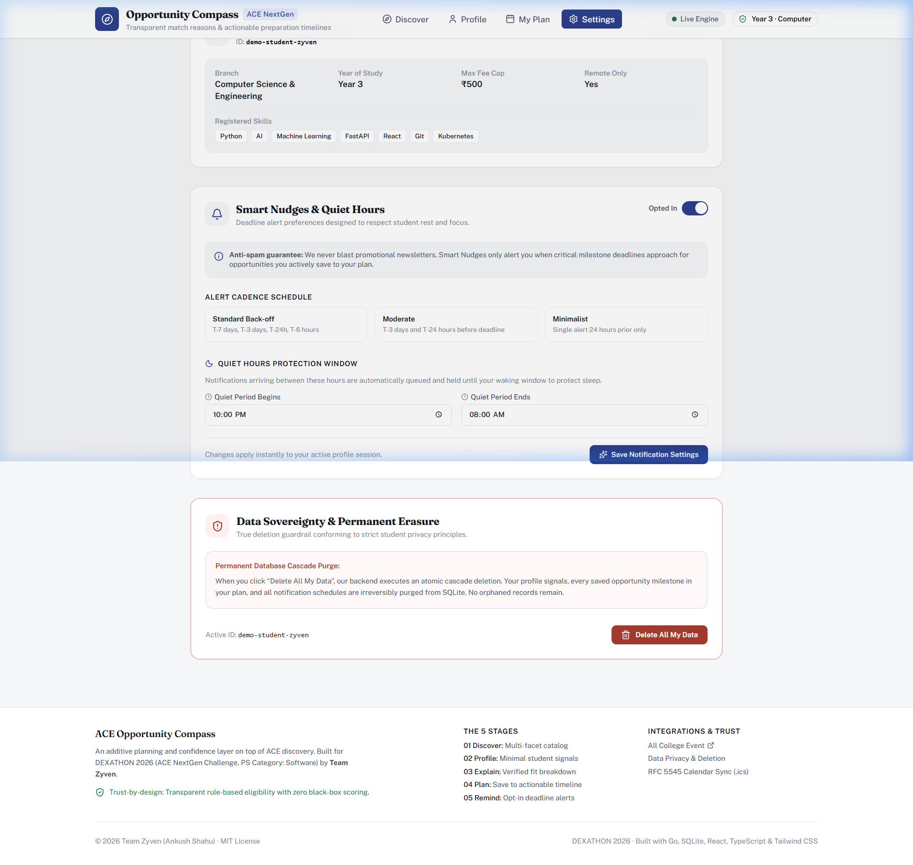
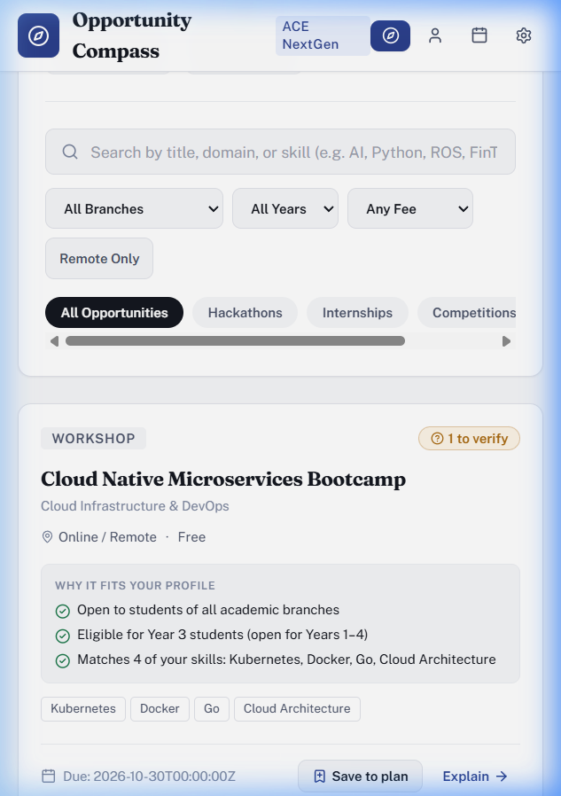

# ACE Opportunity Compass

[](https://dexathon.in)
[](https://allcollegeevent.com)
[](#)
[](LICENSE)
[](https://golang.org)
[](https://react.dev)

> **An additive planning and confidence layer on top of opportunity discovery for college students.**  
> Built for **DEXATHON 2026** · *ACE NextGen Challenge (Problem Statement Category: Software)*  
> **Team Zyven** · Ankush Shahu

---

## 🌟 Executive Summary

Every year, college students discover hundreds of exciting hackathons, internships, competitions, and technical workshops across platforms like [All College Event (ACE)](https://allcollegeevent.com). Yet, the majority of students fail to follow through because of two critical pain points:
1. **Eligibility Anxiety:** Complex, fragmented eligibility criteria (e.g., specific engineering branches, graduation batches, fee thresholds) leave students wondering: *"Am I actually qualified, or will I be disqualified after investing weeks of work?"*
2. **Execution Inertia:** Seeing a deadline like *"Registration closes in 18 days"* provides zero tactical guidance on when to form a team, when to complete an MVP, or when to submit.

**ACE Opportunity Compass** bridges this discovery-to-execution gap. It augments the event catalog with:
- **Transparent 3-Tier Eligibility & Match Explanations:** Explains *why* an event fits your background with verified criteria tags (*Meets*, *Verify with Organizer*, *Unmet*).
- **Automated Milestone Back-off Plans:** Decomposes final deadlines backward into actionable preparation milestones with interactive checkoffs and real-time progress meters.
- **RFC 5545 `.ics` Calendar Export:** 1-click sync into Google Calendar, Apple Calendar, or Outlook.
- **Student Privacy & Sleep Protection:** Strictly opt-in deadline alerts with quiet hours protection (default 22:00–08:00) and permanent cascade data erasure.

---

## 📸 Visual Walkthrough & Milestone Evidence

### Stage 1: Discover Catalog with Multi-Facet Filters & Match Badges
Browse verified opportunities filtered by branch, academic year, registration budget cap, and remote status. Match badges and reasons calculate dynamically against your profile.



*Instant 1-click "Save to plan" mutation creates your personalized preparation roadmap:*


---

### Stage 2: Minimalist Student Signals Profile
Manage your branch, graduation year, skill tags (with 1-click suggestions), location, and registration budget cap. All changes save directly to SQLite.



---

### Stage 3: Explainable Fit & 3-Tier Eligibility Breakdown
Deep-dive into any opportunity. Never an unjustified black-box score — every single criterion is cited with clear badges.



---

### Stage 4: Actionable Milestone Back-off Plan & Progress Tracker
Track milestones backward from event deadlines. Toggle completion status, monitor completion percentage, and export RFC 5545 `.ics` calendar files.



---

### Stage 5: Smart Nudges, Quiet Hours & Permanent Cascade Erasure
Configure sleep-protecting quiet hours and exercise full data sovereignty with atomic SQLite cascade deletion.



---

### Responsive Polish (Mobile 375px Viewport)
Engineered for flawless operation on smartphones, tablets, and desktop workstations.



---

## 🗺 The 5-Stage User Journey

| Stage | Name | Student Experience | Engineering Implementation |
|---|---|---|---|
| **01** | **Discover** | Browse verified opportunities, search keywords, filter by branch/year/cost/remote, view match badges. | `apps/web/src/pages/DiscoverPage.tsx`<br>`GET /api/v1/opportunities` |
| **02** | **Profile** | Enter lightweight academic signals (branch, year, skills, fee cap). Zero tracking, persistent across sessions. | `apps/web/src/pages/ProfilePage.tsx`<br>`POST/GET /api/v1/profiles` |
| **03** | **Explain** | Understand exact fit reasons and 3-tier eligibility breakdown (*Meets*, *Verify with Organizer*, *Unmet*). | `apps/web/src/pages/DetailPage.tsx`<br>`GET /api/v1/opportunities/:id/match` |
| **04** | **Plan** | Convert saved opportunities into backward-scheduled milestones ($T-14\text{d}$, $T-7\text{d}$, $T-3\text{d}$, $T-24\text{h}$) + export `.ics`. | `apps/web/src/pages/PlanPage.tsx`<br>`GET/POST/PATCH /api/v1/plan`<br>`GET /api/v1/plan/:id/ics` |
| **05** | **Remind** | Opt into Smart Nudges, define sleep quiet hours (22:00–08:00), or cascade-purge all personal data. | `apps/web/src/pages/SettingsPage.tsx`<br>`GET/PUT /api/v1/reminders`<br>`DELETE /api/v1/profiles/:id` |

---

## 🏗 Architecture & Tech Stack

```
Dexathon_Team-Zyven/
├── apps/
│   ├── api/                      # Go Fiber v2 REST Backend
│   │   ├── cmd/server/main.go    # Server entrypoint with signal-based graceful shutdown
│   │   ├── internal/             # Domain logic & persistence
│   │   │   ├── store/            # SQLite connection + go:embed migrations runner
│   │   │   ├── models/           # Data contracts (Profile, Opportunity, PlanItem, Reminders)
│   │   │   ├── matching/         # Rules-first matching engine, step generator & RFC 5545 ICS builder
│   │   │   │   ├── matching.go   # 3-tier deterministic eligibility rules engine
│   │   │   │   ├── steps.go      # Backward milestone back-off step generator
│   │   │   │   └── ics.go        # Deterministic RFC 5545 iCalendar stream generator
│   │   │   └── handlers/         # REST endpoints with JSON envelope formatting
│   │   ├── migrations/           # Versioned SQLite DDL migrations (go:embed)
│   │   └── seed/                 # Pre-seeded database with 9 opportunities & demo profile
│   │
│   └── web/                      # React 19 + TypeScript + Vite Frontend
│       ├── src/
│       │   ├── components/       # Header (live ping dot), Footer, Layout
│       │   ├── pages/            # Discover, Profile, Detail, Plan, Settings
│       │   └── lib/              # API Client (Fetch), Design Tokens, Types
│       └── tailwind.config.js    # Custom editorial tokens & palette
│
├── docs/                         # Architecture, Assumptions, Build Brief, Screenshots
├── scripts/                      # Unified launch scripts (dev.sh, dev.bat)
└── LICENSE                       # MIT Open Source License
```

### Technology Highlights
- **Backend:** Go 1.22+ with [Fiber v2](https://gofiber.io) (high-throughput, lightweight HTTP engine with signal-based graceful shutdown).
- **Database:** Pure-Go [modernc.org/sqlite](https://gitlab.com/cznic/sqlite) (zero CGO toolchain requirements, WAL concurrency, relational foreign key cascade).
- **Frontend:** React 19 with TypeScript and [Vite](https://vitejs.dev) (sub-second HMR).
- **Styling:** Tailwind CSS with an editorial design system (Fraunces serif display, Public Sans body, accessible focus rings, WCAG AA contrast).
- **State Management:** [TanStack Query v5](https://tanstack.com/query) for reactive server synchronization and automatic cache invalidation.
- **Calendar Standard:** RFC 5545 compliant `.ics` generator with custom UID and timestamp formatting.

---

## 🚀 Quickstart & Local Execution

### Prerequisites
- [Go 1.22+](https://golang.org/dl/)
- [Node.js 18+](https://nodejs.org/) (includes `npm`)
- Git

### 1. Clone Repository
```bash
git clone https://github.com/TheSnowLord/Dexathon_Team-Zyven.git
cd Dexathon_Team-Zyven
```

### 2. Run with One Command
**On Linux / macOS:**
```bash
chmod +x scripts/dev.sh
./scripts/dev.sh
```

**On Windows (PowerShell / Command Prompt):**
```cmd
.\scripts\dev.bat
```

The script automatically starts both processes:
- 🌐 **Web Application:** `http://127.0.0.1:5173`
- ⚡ **Backend API Server:** `http://127.0.0.1:8080` (Healthcheck: `http://127.0.0.1:8080/api/v1/health`)

---

## 🧪 Testing & Verification

### Run Backend Integration & Unit Tests
```bash
cd apps/api
go test -v ./internal/...
```
*Output: 100% passed (seed tests, matching engine tests, backward step generation, RFC 5545 calendar synthesis, cascade delete handlers).*

### Run Frontend Production Build & Typecheck
```bash
cd apps/web
npm run build
```
*Output: 0 TypeScript errors, production bundle compiled cleanly in < 1 second.*

### Sample API Healthcheck Verification
```bash
curl -s http://127.0.0.1:8080/api/v1/health
```
Response:
```json
{
  "data": {
    "service": "ace-opportunity-compass-api",
    "status": "healthy",
    "version": "1.0.0"
  },
  "error": null
}
```

---

## 🔒 Security, Privacy & True Data Deletion

1. **Zero Tracking:** No tracking pixels, cookies, or third-party behavioral analytics.
2. **Local Session Isolation:** Profile identifier defaults to a seeded demo student (`demo-student-zyven`) for immediate zero-config demoability, but can be switched or re-seeded at any time.
3. **Atomic Cascade Erasure:** When a student clicks **"Delete All My Data"** in Settings, the system calls `DELETE /api/v1/profiles/:id`. SQLite's relational cascade triggers:
   ```sql
   DELETE FROM profiles WHERE id = ?;
   -- Cascades automatically to delete all linked rows in plan_items and reminder_settings
   ```
   Simultaneously, `localStorage` is cleared, ensuring a zero-footprint state.

---

## 📄 Documentation Index

- [Architecture & Schema Specification](docs/ARCHITECTURE.md)
- [Design Assumptions & Rationale](docs/ASSUMPTIONS.md)
- [Original Challenge Build Brief](docs/BUILD_BRIEF.md)
- [Extracted Problem Statement Deck](docs/problem-statement.md)

---

## ⚖️ License

Distributed under the **MIT License**. See [`LICENSE`](LICENSE) for full details.

Developed with pride for **DEXATHON 2026** by **Team Zyven** (Ankush Shahu).