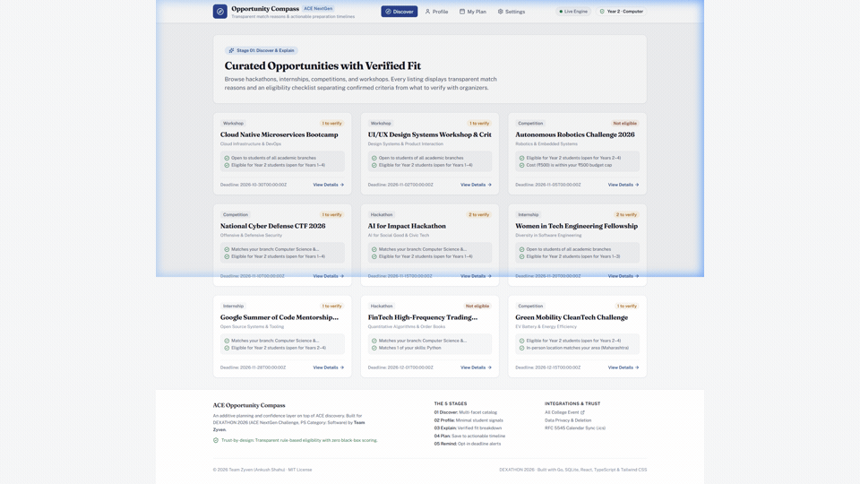
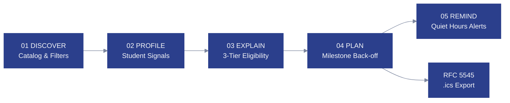
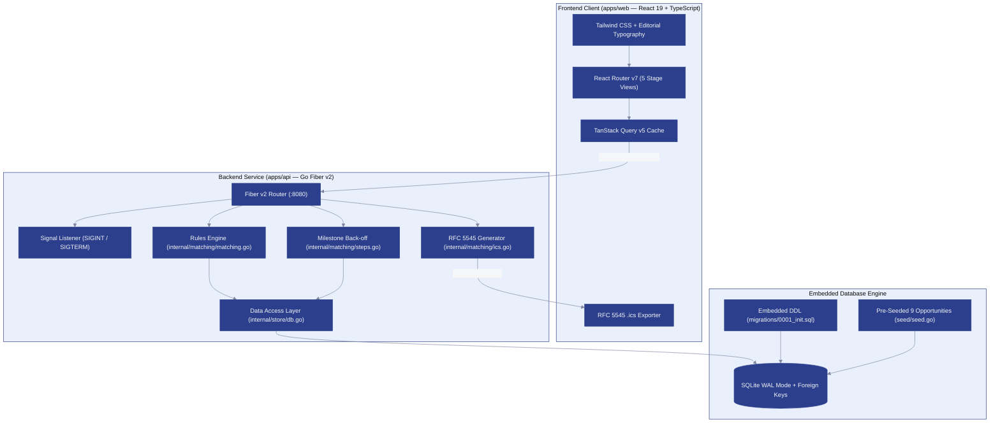

<p align="center">
  
</p>

<p align="center">
  
</p>

<h1 align="center">ACE Opportunity Compass</h1>

<p align="center">
  <strong>An additive planning and confidence layer on top of opportunity discovery for college students.</strong><br>
  Built for <strong>DEXATHON 2026</strong> · <em>ACE NextGen Challenge (Problem Statement Category: Software)</em><br>
  <strong>Team Zyven</strong> · Ankush Shahu
</p>

<p align="center">
  
</p>

<p align="center">
  <a href="https://dexathon.in"></a>
  <a href="https://github.com/TheSnowLord/Dexathon_Team-Zyven/actions/workflows/ci.yml"></a>
  <a href="https://go.dev"></a>
  <a href="https://gofiber.io"></a>
  <a href="https://react.dev"></a>
  <a href="https://www.typescriptlang.org"></a>
  <a href="https://tailwindcss.com"></a>
  <a href="https://gitlab.com/cznic/sqlite"></a>
  <a href="LICENSE"></a>
</p>

---

## ◈ 01 — Product Walkthrough

A complete, live walkthrough of the 5-stage student journey running against the pure-Go SQLite backend and React 19 interface:

<p align="center">
  
</p>

---

## ◈ 02 — The Problem

> *"The bottleneck isn’t discovery. It’s follow-through."*  
> — DEXATHON 2026 Problem Discovery Brief (`docs/problem-statement.md`)

Every academic year, students discover hundreds of hackathons, internships, competitions, and technical workshops across platforms like [All College Event (ACE)](https://allcollegeevent.com). Yet, the majority of students abandon opportunities due to two severe friction points:

1. **Eligibility Anxiety:** Complex, fragmented eligibility criteria (e.g., restricted engineering branches, strict graduation batches, team composition rules, registration fees) leave students asking: *"Am I actually qualified, or will I be disqualified after investing weeks of work?"*
2. **Execution Inertia:** Seeing a date like *"Closes in 18 days"* provides zero tactical momentum. Students do not need another bookmark list; they need to know when to form a team, when to complete an MVP, and when to rehearse their submission.

---

## ◈ 03 — The Solution

**ACE Opportunity Compass** is an additive planning and confidence layer on top of All College Event discovery. It does not replace the discovery feed — it augments it with actionable certainty:

- **Rules-First Eligibility:** Explains *why* an event fits your student background with a transparent 3-tier criteria breakdown (**Meets**, **Verify with Organizer**, **Unmet**).
- **Automated Milestone Back-off:** Converts saved opportunities into backward-scheduled preparation milestones ($T-14\text{d}$, $T-7\text{d}$, $T-3\text{d}$, $T-24\text{h}$) with real-time completion tracking.
- **RFC 5545 `.ics` Export:** Single-click sync into Google Calendar, Apple Calendar, or Microsoft Outlook.
- **Student Privacy & Sleep Protection:** Smart Nudges are strictly **Default OFF** until opted in, supported by a configurable **Quiet Hours Window** (22:00–08:00) and permanent cascade data erasure.

---

## ◈ 04 — The Five-Stage Flow

```
01 — DISCOVER   Multi-facet catalog search & instant match badge preview
                Page: apps/web/src/pages/DiscoverPage.tsx | Endpoint: GET /api/v1/opportunities

02 — PROFILE    Lightweight student signals (branch, year, dynamic skills, budget cap)
                Page: apps/web/src/pages/ProfilePage.tsx  | Endpoint: POST/GET /api/v1/profiles

03 — EXPLAIN    Transparent 3-tier eligibility breakdown with direct rule citations
                Page: apps/web/src/pages/DetailPage.tsx   | Endpoint: GET /api/v1/opportunities/:id/match

04 — PLAN       Backward-scheduled milestone checklist with progress tracking & RFC 5545 .ics
                Page: apps/web/src/pages/PlanPage.tsx     | Endpoint: POST/GET/PATCH /api/v1/plan

05 — REMIND     Opt-in deadline nudges with quiet hours protection & cascade data deletion
                Page: apps/web/src/pages/SettingsPage.tsx | Endpoint: GET/PUT /api/v1/reminders
```

---

## ◈ 05 — Product Pipeline Flow



---

## ◈ 06 — Trust & Eligibility Model

Opaque recommendation algorithms ("87% match") create false expectations and confusion. ACE Opportunity Compass operates on a **strictly deterministic, rules-first eligibility engine**:

| Tier | Status Color | Token Hex | Semantic Meaning |
|---|---|---|---|
| **Meets** | Deep Emerald | `#1F7A4D` | Criteria programmatically verified against student signals (e.g. branch match, year match, cost within budget cap). |
| **Verify** | Amber | `#A9690F` | Subjective or external criteria requiring organizer confirmation (e.g. cross-college team allowance, prior hackathon experience preferred). |
| **Unmet** | Muted Rust | `#A13A2E` | Explicit disqualifications (e.g. branch restricted, year out of bounds, registration cost exceeds student cap). |

### Privacy & Trust Guardrails
- **Default OFF Reminders:** Notifications never send unsolicited marketing or promotional blasts.
- **Sleep Protection Window:** During Quiet Hours (default `22:00` to `08:00`), notifications are held in queue to protect student rest and focus.
- **True Right-to-Erasure:** Calling `DELETE /api/v1/profiles/:id` initiates an atomic SQLite `ON DELETE CASCADE` that permanently purges student signals, plan items, milestone steps, and reminder settings.

---

## ◈ 07 — Verified Tech Stack

Every technology in this stack has been verified against `apps/api/go.mod` and `apps/web/package.json`:

| Layer | Technology | Version | Architectural Role |
|---|---|---|---|
| **Backend Runtime** | Go | `1.22+` | High-performance, lightweight compiled backend service. |
| **HTTP Framework** | Fiber v2 | `v2.52.15` | Fast HTTP routing with CORS, structured logger, and signal recovery. |
| **Database Engine** | SQLite (`modernc.org/sqlite`) | `v1.46.1` | Pure-Go embedded database (zero CGO toolchain requirements, WAL concurrency). |
| **Migrations** | Go standard library (`embed`) | `1.22+` | Automated DDL migrations baked directly into the Go executable. |
| **Frontend Framework** | React | `^19.3.1` | React 19 component hierarchy with standard DOM event model. |
| **Language** | TypeScript | `~7.0.2` | Complete end-to-end type safety across API client and UI models. |
| **Build Tool** | Vite | `^8.3.4` | Sub-second HMR and production bundle optimization. |
| **Design System** | Tailwind CSS | `^3.4.19` | Custom tokenized color palette and responsive typography. |
| **Server State** | TanStack Query | `^5.104.5` | Reactive query caching, optimistic UI updates, and mutation invalidation. |
| **Icons** | Lucide React | `^1.59.0` | Accessible SVG icon library. |
| **Calendar Spec** | RFC 5545 | `2.0` | Native `.ics` iCalendar feed generation. |

> **Architectural Note:** There is **no LLM or generative AI call** anywhere in this application. The matching engine is 100% deterministic, rules-first, and explainable — an intentional design choice to guarantee student trust.

---

## ◈ 08 — System Architecture



---

## ◈ 09 — Getting Started

### Prerequisites
- **Go:** `1.22+`
- **Node.js:** `20+` (includes `npm`)
- **Git**

### 1. Clone Repository
```bash
git clone https://github.com/TheSnowLord/Dexathon_Team-Zyven.git
cd Dexathon_Team-Zyven
```

### 2. Configure Environment (Optional)
The project ships with pre-configured defaults in `.env.example`:
```ini
PORT=8080
ENV=development
DATABASE_URL=data/compass.db
VITE_API_URL=http://localhost:8080
```

### 3. One-Click Launch
**On Linux / macOS:**
```bash
chmod +x scripts/dev.sh
./scripts/dev.sh
```

**On Windows (PowerShell / Command Prompt):**
```cmd
.\scripts\dev.bat
```

- 🌐 **Web Interface:** `http://127.0.0.1:5173`
- ⚡ **REST API Server:** `http://127.0.0.1:8080` (Health: `http://127.0.0.1:8080/api/v1/health`)

---

## ◈ 10 — API Reference

All responses conform to the standard envelope format: `{"data": ..., "error": null}`.

| Endpoint | Method | Stage | Purpose |
|---|---|---|---|
| `/api/v1/health` | `GET` | System | Healthcheck and database connectivity ping |
| `/api/v1/profiles/:id` | `GET` | 02 Profile | Retrieve academic signals for a student profile |
| `/api/v1/profiles` | `POST` | 02 Profile | Upsert student profile signals |
| `/api/v1/profiles/:id` | `DELETE` | 05 Remind | Atomic cascade purge of profile, plans, and settings |
| `/api/v1/opportunities` | `GET` | 01 Discover | Query opportunities with branch/year/budget filters |
| `/api/v1/opportunities/:id` | `GET` | 03 Explain | Detailed opportunity view with 3-tier eligibility report |
| `/api/v1/opportunities/:id/match` | `GET` | 03 Explain | Compute eligibility against a specific profile |
| `/api/v1/plan` | `GET` | 04 Plan | List saved plan items and milestones for profile |
| `/api/v1/plan` | `POST` | 04 Plan | Save opportunity to plan and generate milestone steps |
| `/api/v1/plan/:id` | `PATCH` | 04 Plan | Update milestone step completion or plan status |
| `/api/v1/plan/:id` | `DELETE` | 04 Plan | Remove opportunity from preparation plan |
| `/api/v1/plan/:id/ics` | `GET` | 04 Plan | Download RFC 5545 `.ics` calendar file for a plan item |
| `/api/v1/reminders` | `GET` | 05 Remind | Fetch notification preferences and quiet hours |
| `/api/v1/reminders` | `PUT` | 05 Remind | Update opt-in status, cadence, and quiet hours |

### Verified Sample API Responses

<details>
<summary><strong>GET /api/v1/health</strong></summary>

```json
{
  "data": {
    "service": "ACE Opportunity Compass API",
    "status": "ok",
    "version": "v1.0.0"
  },
  "error": null
}
```
</details>

<details>
<summary><strong>GET /api/v1/opportunities/opp-ai-impact-2026?profileId=demo-student-zyven</strong></summary>

```json
{
  "data": {
    "match": {
      "opportunity_id": "opp-ai-impact-2026",
      "match_reasons": [
        "Matches your branch: Information Technology",
        "Eligible for Year 3 students (open for Years 1–4)",
        "Matches your remote participation preference",
        "Free registration (no participation cost)"
      ],
      "eligibility": {
        "meets": [
          "Enrolled undergraduate engineering student (Years 1-4)",
          "Eligible for CSE, IT, or ECE branch"
        ],
        "verify": [
          "Team size between 2 and 4 members — Verify team formation",
          "Prior hackathon experience or project repository preferred"
        ],
        "unmet": []
      },
      "fit_badge": "2 to verify",
      "score_percent": 95
    },
    "opportunity": {
      "id": "opp-ai-impact-2026",
      "title": "AI for Impact Hackathon",
      "theme": "AI for Social Good & Civic Tech",
      "category": "hackathon",
      "branches": [
        "Computer Science & Engineering",
        "Information Technology",
        "Electronics & Communication"
      ],
      "min_year": 1,
      "max_year": 4,
      "skills_tags": ["Python", "AI", "Machine Learning", "FastAPI", "React"],
      "location": "Pune / Online",
      "is_remote": true,
      "cost": 0,
      "deadline": "2026-11-15T00:00:00Z",
      "source_url": "https://allcollegeevent.com/events/ai-for-impact-hackathon"
    }
  },
  "error": null
}
```
</details>

<details>
<summary><strong>GET /api/v1/plan/:id/ics (RFC 5545 iCalendar Stream)</strong></summary>

```ics
BEGIN:VCALENDAR
VERSION:2.0
PRODID:-//ACE Opportunity Compass//Team Zyven//EN
CALSCALE:GREGORIAN
METHOD:PUBLISH
BEGIN:VEVENT
UID:c2ed848f-9a09-4e0e-9626-20e41663e77c-0@opportunitycompass.ace
DTSTAMP:20261020T015418Z
DTSTART;VALUE=DATE:20261027
DTEND;VALUE=DATE:20261028
SUMMARY:Read official guidelines and verify checklist items with organizer [AI for Impact Hackathon]
DESCRIPTION:Opportunity Compass preparation milestone for AI for Impact Hackathon.\nSource: https://allcollegeevent.com/events/ai-for-impact-hackathon
STATUS:NEEDS-ACTION
END:VEVENT
END:VCALENDAR
```
</details>

---

## ◈ 11 — Visual Identity & Tokens

The UI follows an accessible editorial design system based on `apps/web/src/lib/tokens.ts`:

| Token | Hex Swatch | Role | Usage |
|---|---|---|---|
| **Canvas** | `` `#F5F6F8` | Background | Main application canvas background |
| **Ink** | `` `#14171F` | Foreground | High-contrast typography & badge labels |
| **Ink Muted** | `` `#4A5268` | Secondary Text | Subheadings & descriptive body copy |
| **Primary** | `` `#2B3F8C` | Brand / Accent | Deep indigo brand tone, buttons, active tabs |
| **Meets** | `` `#1F7A4D` | Confirmed Fit | Emerald badge for verified criteria |
| **Verify** | `` `#A9690F` | Verify with Organizer | Amber badge for subjective/unverified criteria |
| **Unmet** | `` `#A13A2E` | Disqualification | Muted rust badge for unmet criteria & danger zone |
| **Border** | `` `#E2E4EA` | Hairline Rule | Card borders, dividers, subtle separators |

---

## ◈ 12 — Project Structure

```
Dexathon_Team-Zyven/
├── .github/
│   └── workflows/
│       └── ci.yml                 # Automated Go + React CI pipeline
├── apps/
│   ├── api/                       # Go Fiber v2 REST Backend
│   │   ├── cmd/
│   │   │   └── server/
│   │   │       └── main.go        # Server entrypoint with signal-based graceful shutdown
│   │   ├── internal/              # Core domain logic
│   │   │   ├── handlers/          # REST route handlers with JSON envelope formatting
│   │   │   │   ├── handlers.go
│   │   │   │   └── handlers_test.go
│   │   │   ├── matching/          # Deterministic rules-first matching engine
│   │   │   │   ├── matching.go    # 3-tier eligibility evaluation
│   │   │   │   ├── steps.go       # Backward milestone back-off step generator
│   │   │   │   └── ics.go         # RFC 5545 iCalendar stream builder
│   │   │   ├── models/            # Data models (Profile, Opportunity, PlanItem, Reminders)
│   │   │   │   └── models.go
│   │   │   └── store/             # SQLite database layer with WAL mode & foreign keys
│   │   │       └── db.go
│   │   ├── migrations/            # Embedded SQLite DDL migrations
│   │   │   ├── 0001_init.sql
│   │   │   └── embed.go
│   │   ├── seed/                  # Realistic 9-opportunity seed dataset & demo profile
│   │   │   ├── seed.go
│   │   │   └── seed_test.go
│   │   ├── go.mod
│   │   └── go.sum
│   │
│   └── web/                       # React 19 + TypeScript + Vite Frontend
│       ├── public/
│       │   ├── compass-icon.svg   # Official Opportunity Compass logo
│       │   └── favicon.svg
│       ├── src/
│       │   ├── components/layout/ # Header (live ping dot), Footer, App Layout
│       │   │   ├── Header.tsx
│       │   │   ├── Footer.tsx
│       │   │   └── Layout.tsx
│       │   ├── lib/               # Typed API client and design tokens
│       │   │   ├── api.ts
│       │   │   └── tokens.ts
│       │   ├── pages/             # Five-stage view controllers
│       │   │   ├── DiscoverPage.tsx
│       │   │   ├── ProfilePage.tsx
│       │   │   ├── DetailPage.tsx
│       │   │   ├── PlanPage.tsx
│       │   │   └── SettingsPage.tsx
│       │   ├── index.css          # Tokenized CSS & accessible focus rings
│       │   └── main.tsx           # Client entrypoint & TanStack Query provider
│       ├── package.json
│       ├── tailwind.config.js
│       └── vite.config.ts
│
├── docs/                          # Architecture & design specifications
│   ├── screenshots/               # Visual proof and walkthrough GIF
│   ├── ARCHITECTURE.md            # Detailed architecture specification
│   ├── ASSUMPTIONS.md             # Design assumptions & engineering pivots
│   ├── BUILD_BRIEF.md             # Challenge build brief
│   └── problem-statement.md       # Extracted pitch deck text
├── scripts/
│   ├── dev.bat                    # One-click dual launcher for Windows
│   └── dev.sh                     # POSIX bash launcher with trap handlers
├── .env.example
├── .gitignore
├── LICENSE                        # MIT License
└── README.md
```

---

## ◈ 13 — Testing & Verification

The codebase is backed by automated test suites on both layers:

### 1. Backend Go Test Suites
```bash
cd apps/api
go test -v ./...
```
- **Total Test Code:** `221` lines across `handlers_test.go` and `seed_test.go`.
- **`TestAPICoreFlow`:** Exercises full REST flow: profile upsert, opportunity filtering, rules-first match evaluation, plan item creation, milestone checkoffs, RFC 5545 `.ics` export, and cascade deletion.
- **`TestSeedDatabase`:** Asserts schema initialization, foreign key constraints, default demo profile creation, and presence of all 9 diverse seed opportunities (including *"AI for Impact Hackathon"*).

### 2. Frontend Production Compilation
```bash
cd apps/web
npm run build
```
- **Zero TypeScript errors** (`tsc -b`).
- Sub-second production bundle compilation via Vite (~`111 KB` gzipped JS, `5.17 KB` gzipped CSS).

### 3. Continuous Integration Status
GitHub Actions workflow [`.github/workflows/ci.yml`](.github/workflows/ci.yml) executes on every push and pull request to `main`.
- **Run ID:** [39354435608](https://github.com/TheSnowLord/Dexathon_Team-Zyven/actions/runs/39354435608) — `✓ All jobs passed` (Frontend build & Go test suite).

---

## ◈ 14 — Deliberate Scope & Limitations

As documented in [`docs/ASSUMPTIONS.md`](docs/ASSUMPTIONS.md):

1. **Planning Layer, Not Official Authority:** ACE Opportunity Compass is designed to build student confidence and follow-through. It does not replace official event registration portals or organizer terms. Any subjective requirement is marked **Verify with Organizer**.
2. **Illustrative Seed Data:** Seed opportunities are realistic illustrative examples across hackathons, internships, competitions, and workshops to exercise multi-facet filtering. They do not claim to scrape live private listings.
3. **No External Cloud Dependencies:** The database is self-contained in pure Go SQLite (`compass.db`). Evaluators can clone and run the application immediately with zero Docker, PostgreSQL, or cloud account prerequisites.

---

## ◈ 15 — Contributing & Verification Protocol

1. Fork the repository and create a feature branch (`git checkout -b feat/your-feature`).
2. Adhere to **Conventional Commits** (`feat:`, `fix:`, `docs:`, `chore:`).
3. Confirm `go test ./...` passes in `apps/api` and `npm run build` succeeds in `apps/web`.
4. Ensure all new UI elements adhere to the brand tokens in `apps/web/src/lib/tokens.ts`.
5. Submit a pull request against `main`.

---

## ◈ 16 — License

Distributed under the **MIT License**. See [`LICENSE`](LICENSE) for complete terms.

<p align="center">
  
</p>

<p align="center">
  <br>
  <strong>ACE Opportunity Compass</strong> · Built with pride for <strong>DEXATHON 2026</strong> by <strong>Team Zyven</strong>
</p>