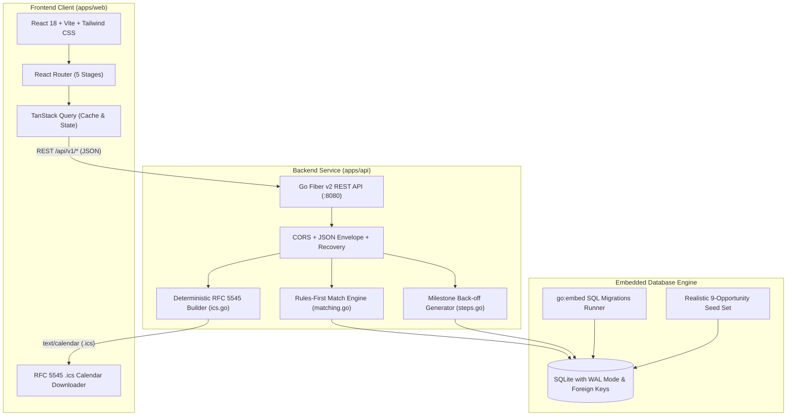
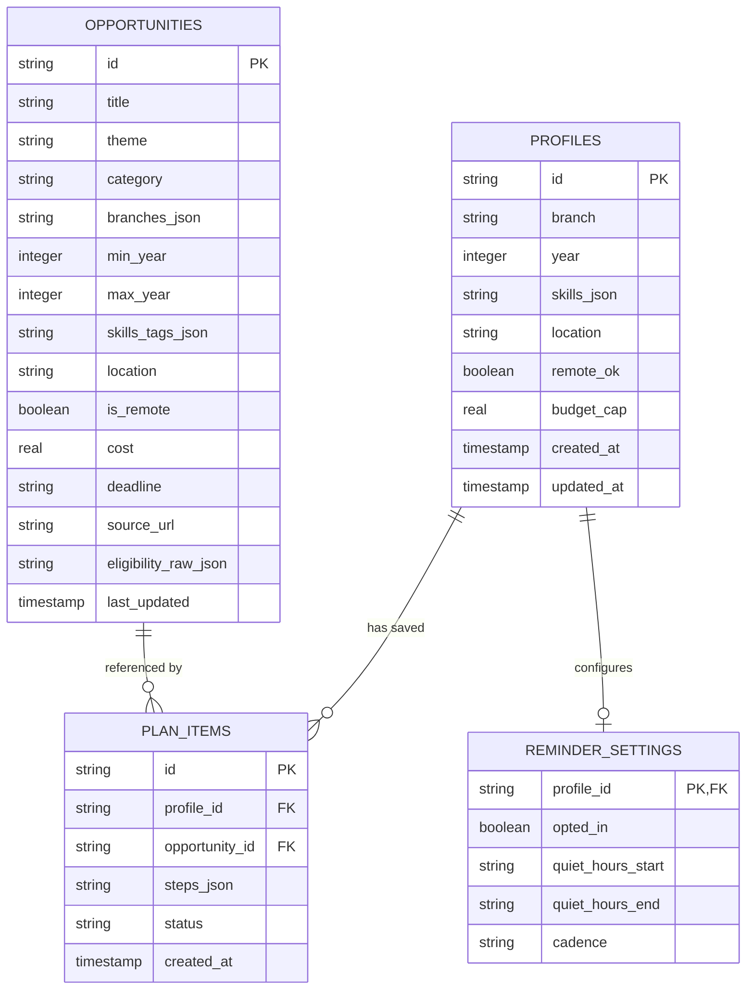

# ACE Opportunity Compass — Architecture & Engineering Specification

> **DEXATHON 2026** · *ACE NextGen Challenge (Problem Statement Category: Software)*  
> **Team Zyven** · Ankush Shahu

---

## 1. System Philosophy & Objectives

The **ACE Opportunity Compass** is an additive planning and confidence layer built on top of the All College Event (ACE) discovery platform. It transforms passive event browsing into an active, actionable roadmap for college students through transparent, rule-based matching and backward-scheduled milestone plans.

### Core Architectural Tenets
1. **Explainability Over Black Boxes:** No opaque recommendation algorithms or mysterious AI scores. Every eligibility assessment provides transparent criteria categorized into **Meets**, **Verify with Organizer**, and **Unmet**.
2. **Deterministic Milestone Back-off:** When an opportunity is saved, deadlines are decomposed backward into realistic, actionable preparation milestones (e.g., T-14d team formation, T-7d prototype MVP, T-3d deck refinement, T-24h dry run).
3. **Student Privacy Sovereignty:** Lightweight, opt-in student signals. True data deletion guardrails ensure that calling `DELETE /api/v1/profiles/:id` initiates an atomic SQLite cascade delete across plans, steps, and reminders.
4. **Anti-Spam & Sleep Protection:** Smart Nudges are **Default OFF** and strictly opt-in. A configurable **Quiet Hours Window** guarantees that notifications never intrude during sleep or deep focus study periods.

---

## 2. End-to-End System Architecture



---

## 3. The 5 Core Stages

| Stage | Name | Key Purpose | Implementation Surface |
|---|---|---|---|
| **01** | **Discover** | Multi-facet catalog search, branch/year/budget filtering, verified match badge preview, instant 1-click "Save to plan" | `apps/web/src/pages/DiscoverPage.tsx`<br>`GET /api/v1/opportunities` |
| **02** | **Profile** | Lightweight, editable student signals (branch, year, dynamic skills tags, max fee cap, remote preference) | `apps/web/src/pages/ProfilePage.tsx`<br>`POST/GET /api/v1/profiles` |
| **03** | **Explain** | 3-tier eligibility breakdown (*Meets*, *Verify with Organizer*, *Unmet*) with direct requirement citations and fit reasons | `apps/web/src/pages/DetailPage.tsx`<br>`GET /api/v1/opportunities/:id/match` |
| **04** | **Plan** | Backward-scheduled milestone steps with interactive checkoff, real-time progress bar, status switcher, and RFC 5545 `.ics` export | `apps/web/src/pages/PlanPage.tsx`<br>`GET/POST/PATCH /api/v1/plan` |
| **05** | **Remind** | Opt-in Smart Nudges with cadence tiers, quiet hours sleep protection window, and permanent cascade data deletion | `apps/web/src/pages/SettingsPage.tsx`<br>`GET/PUT /api/v1/reminders`<br>`DELETE /api/v1/profiles/:id` |

---

## 4. Database Schema (SQLite)

The database uses pure Go SQLite (`modernc.org/sqlite`) running in **Write-Ahead Logging (WAL)** mode with **Foreign Key enforcement** enabled:



### Deletion Cascade Guarantee
```sql
CREATE TABLE plan_items (
    id TEXT PRIMARY KEY,
    profile_id TEXT NOT NULL REFERENCES profiles(id) ON DELETE CASCADE,
    opportunity_id TEXT NOT NULL REFERENCES opportunities(id) ON DELETE CASCADE,
    steps_json TEXT NOT NULL,
    status TEXT NOT NULL DEFAULT 'saved',
    created_at DATETIME DEFAULT CURRENT_TIMESTAMP
);

CREATE TABLE reminder_settings (
    profile_id TEXT PRIMARY KEY REFERENCES profiles(id) ON DELETE CASCADE,
    opted_in BOOLEAN NOT NULL DEFAULT 0,
    quiet_hours_start TEXT NOT NULL DEFAULT '22:00',
    quiet_hours_end TEXT NOT NULL DEFAULT '08:00',
    cadence TEXT NOT NULL DEFAULT 'T-7d, T-3d, T-1d, T-6h'
);
```
Executing `DELETE FROM profiles WHERE id = ?` cascades immediately to purge all saved plans, checklists, and notification settings atomically.

---

## 5. REST API Surface Contract

All responses conform to the standard envelope format:
```json
{
  "data": { ... },
  "error": null
}
```

### Endpoints
- `GET /api/v1/health` — Service health and uptime
- `GET /api/v1/profiles/:id` — Retrieve student signals
- `POST /api/v1/profiles` — Upsert student signals
- `DELETE /api/v1/profiles/:id` — Permanently purge student profile and all cascaded data
- `GET /api/v1/opportunities` — Query opportunities with optional query filters and match scoring
- `GET /api/v1/opportunities/:id` — Detail view of opportunity with full 3-tier eligibility report
- `GET /api/v1/opportunities/:id/match` — Explicit match computation against a student profile
- `GET /api/v1/plan` — Retrieve saved plan items and milestone checklist for active profile
- `POST /api/v1/plan` — Add opportunity to plan and generate backward milestones
- `PATCH /api/v1/plan/:id` — Toggle step completion status or change plan status
- `DELETE /api/v1/plan/:id` — Remove opportunity from plan
- `GET /api/v1/plan/:id/ics` — Download RFC 5545 compliant `.ics` calendar file
- `GET /api/v1/plan/ics` — Export entire student preparation plan as calendar schedule
- `GET /api/v1/reminders` — Fetch student notification preferences and quiet hours
- `PUT /api/v1/reminders` — Update opt-in status, cadence, and quiet hours window

---

## 6. RFC 5545 Calendar Generation Contract

Calendar generation produces compliant iCalendar feeds containing:
- `PRODID:-//ACE Opportunity Compass//Team Zyven//EN`
- `VERSION:2.0`
- `CALSCALE:GREGORIAN`
- Opportunity milestone event (`VEVENT`) with:
  - `UID` generated uniquely per milestone step
  - `DTSTART` and `DTEND` formatted in `YYYYMMDDTHHMMSSZ`
  - `SUMMARY`: Opportunity title + specific back-off task description
  - `DESCRIPTION`: Back-off milestone details with ACE source link
  - `STATUS:CONFIRMED`
